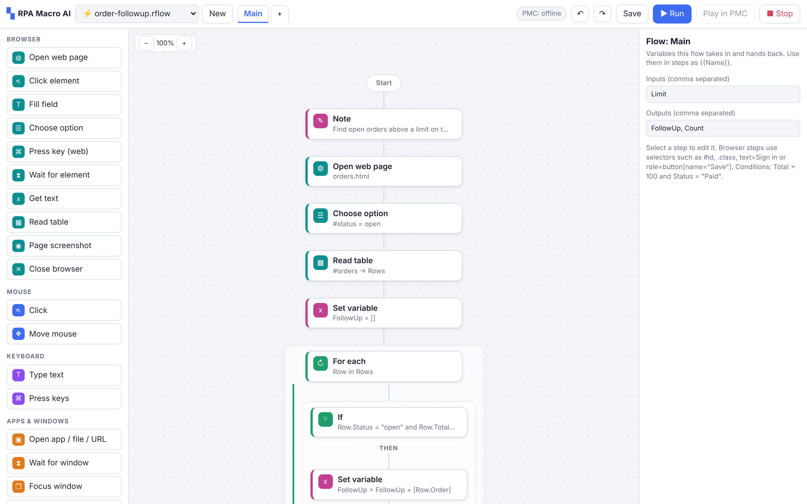
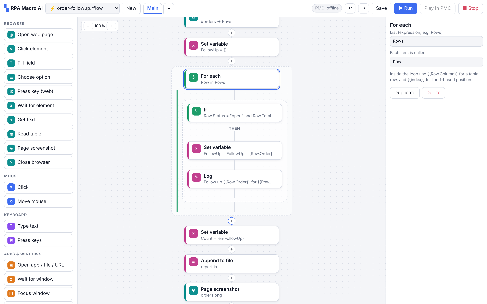
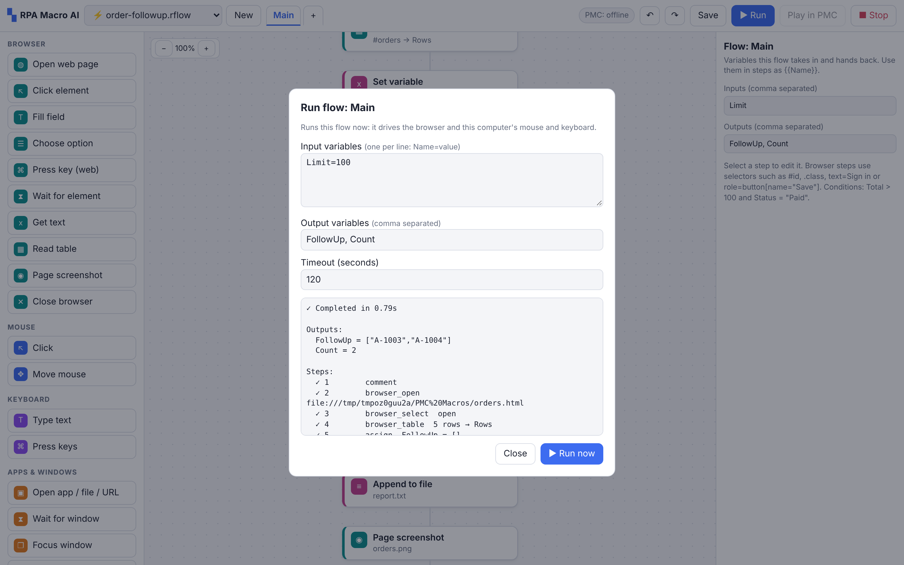
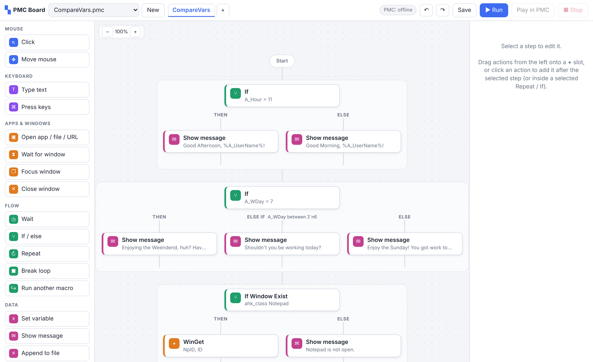
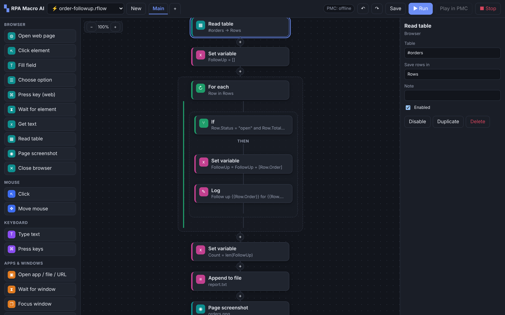

# RPA Macro AI

Agentic **browser + desktop** automation built on Pulover's Macro Creator (PMC). It has three layers
that share one set of files and tools:

| Layer | What it does | Files |
|---|---|---|
| **Desktop macros** | PMC records and plays Windows mouse/keyboard macros. They run headless with input and output variables, and AI agents can drive the live app (including recording a demonstration). | `.pmc` |
| **Browser** | Playwright automation of Edge or Chrome: open, click, fill, select, wait, read text and whole tables, screenshots. Logins persist with `PMC_BROWSER_PROFILE`. | – |
| **Flows** | Repeatable automations that mix browser steps, desktop steps and PMC macros, with variables, If/Else, Repeat and **For each** (e.g. for each row of a scraped table). | `.rflow` |

You can use it four ways:

* **AI agents** (Claude Desktop, Claude Code, Cursor, any MCP client) through the `pmc-mcp` MCP
  server: they observe the screen and pages, build flows and macros, run them and check the results.
* **The Visual Board**: a drag-and-drop editor for flows and macros (`pmc-board`, or
  File → Visual Board… in PMC).
* **The command line** for schedulers and other RPA tools: `pmc-run invoice.rflow --input Limit=100`.
* **Other RPA platforms**: UiPath, Robomotion and Automation Anywhere (see below).

```
 AI agent ──MCP──► pmc-mcp ─┬─ browser_*  ──────────► Playwright ─► Edge / Chrome
 Visual Board ─HTTP─┐       ├─ flow_* / engine ─────► runs .rflow: browser + desktop + PMC macros
 pmc-run ───────────┴──────►├─ desktop_* ───────────► AutoHotkey v1 snippets (click, keys, windows, image search)
                            ├─ macro_* / macro_run ─► .pmc files; MacroCreator -new -s<n> (headless, inputs/outputs)
                            └─ pmc_* ───────────────► LIB\AgentBridge.ahk inside the running PMC (play / stop / record)
```

## Flows (`.rflow`)

A flow is a list of steps. Text parameters can use `{{expressions}}` such as `{{Row.Customer}}`.
Conditions use a small, safe expression language (`Total > 100 and Status = "Paid"`,
`len(Rows) > 0`), with no `eval`. This is the shipped example,
[`examples/order-followup`](examples/order-followup/order-followup.rflow), in the compact form agents
write:

```json
[
  {"kind": "browser_open", "url": "orders.html"},
  {"kind": "browser_select", "selector": "#status", "value": "open"},
  {"kind": "browser_table", "selector": "#orders", "var": "Rows"},
  {"kind": "assign", "var": "FollowUp", "value": "[]", "expression": true},
  {"kind": "foreach", "items": "Rows", "item": "Row", "steps": [
    {"kind": "if", "condition": "Row.Status = \"open\" and Row.Total > Limit", "then": [
      {"kind": "assign", "var": "FollowUp", "value": "FollowUp + [Row.Order]", "expression": true},
      {"kind": "log", "message": "Follow up {{Row.Order}} for {{Row.Customer}}"}]}]},
  {"kind": "file_append", "text": "Orders to follow up: {{FollowUp}}\n", "path": "report.txt"},
  {"kind": "type_text", "text": "Follow up: {{FollowUp}}", "window": "ahk_exe notepad.exe"}
]
```

```bash
pmc-run examples/order-followup/order-followup.rflow --input Limit=100 --output FollowUp
```

This returns `{"completed": true, "outputs": {"FollowUp": ["A-1003", "A-1004"]}, "log": [...]}`. A
failing step is reported by its position, e.g. `step 6[3].1.1 (browser_click): ...`.

**Step kinds:**
- **Browser:** `browser_open`, `browser_click`, `browser_fill`, `browser_select`, `browser_press`,
  `browser_wait`, `browser_extract`, `browser_table`, `browser_screenshot`, `browser_close`.
- **Desktop (Windows):** `click`, `mouse_move`, `type_text`, `send_keys`, `run`, `win_wait`,
  `win_activate`, `win_close`, `msgbox`, `command`.
- **PMC:** `run_macro`, which runs a `.pmc` macro with inputs; its outputs become flow variables.
- **Data and control:** `assign`, `log`, `file_append`, `sleep`, `comment`, `break`, plus the blocks
  `if` / `elif` / `else`, `loop` and `foreach`.

Call the MCP tool `flow_step_kinds` for every parameter. Relative paths resolve next to the flow
file.



## Visual Board

A drag-and-drop editor for flows (`.rflow`) and PMC macros (`.pmc`) that runs in your browser. The
palette adapts to the file: flows get the Browser group, For each, Run PMC macro and Log.

* **Build visually:** drag actions (click, type, keys, open app, wait for window, if/else, repeat,
  variables…) from the palette onto the **+** slots, then fill in the settings panel. If/Else-if/Else
  branches sit side by side and loops wrap their body.
* **Same files as PMC:** the board edits `.pmc` projects directly. Anything built on the board opens
  in classic PMC and the other way round; rows the board has no form for are shown as raw PMC rows,
  and steps you don't touch are saved exactly as they were.
* **Run from the board:** **▶ Run** runs the macro headless with input and output variables;
  **Play in PMC** plays it in the open PMC window; **■ Stop** aborts.
* **Works alongside AI agents:** when an agent edits the open file through MCP, the board reloads
  it live (or warns you if you have unsaved edits). Agents can open the board for you with the
  `board_open` tool.
* Undo/redo, Ctrl+S, Delete, Ctrl+D (duplicate), zoom, multiple macros as tabs, dark mode.

| | |
|---|---|
|  |  |
|  |  |

Open it from PMC with **File → Visual Board…**, or from a terminal:

```bash
pmc-board "C:\Users\me\Documents\PMC Macros\invoice.pmc"
```

It listens on `127.0.0.1` only, and the link it opens carries a per-launch access token, so other
web pages can't drive it. It exits on its own about two minutes after you close the tab.

## Other RPA platforms

| Platform | How PMC plugs in | Folder |
|---|---|---|
| **UiPath** | A coded MCP server for Orchestrator, built with UiPath's `uipath-mcp` SDK. `uipath init` and `uipath pack` were verified. | [`integrations/uipath`](integrations/uipath/README.md) |
| **Robomotion** | An entry for the `robomotion-mcps` catalog, so Teams agents can switch PMC on. It passes the catalog's `validate.sh`. | [`integrations/robomotion`](integrations/robomotion/README.md) |
| **Automation Anywhere** | Bots call `pmc-run` or the `run_json` Python function to run a macro with inputs and outputs. | [`integrations/automation-anywhere`](integrations/automation-anywhere/README.md) |
| Anything else | `pmc-run file.rflow\|file.pmc --input K=V --output X [--result-file r.json]` prints JSON. Exit codes: 0 completed, 2 incomplete, 3 timed out, 1 error. | – |

All of them get everything here, browser automation and flows included: the MCP integrations expose
every tool, and `pmc-run` / `run_json` run `.rflow` flows as well as `.pmc` macros.

## Install (Windows)

1. Python 3.10+ and, for the desktop tools, **AutoHotkey v1.1** (<https://www.autohotkey.com>).
   The AHK v2 installer can install v1 side by side; the server finds both layouts. Browser steps use
   the Microsoft Edge that comes with Windows, so nothing else needs downloading.
2. From this folder:

   ```bash
   pip install .
   ```

3. Register it with your MCP client. For Claude Desktop, add this to `claude_desktop_config.json`:

   ```json
   {
     "mcpServers": {
       "pmc": {
         "command": "pmc-mcp",
         "env": {
           "PMC_EXE": "C:\\Program Files\\MacroCreator\\MacroCreator.exe",
           "PMC_MCP_ROOTS": "C:\\Users\\me\\Documents\\PMC Macros",
           "PMC_MCP_LEVEL": "standard"
         }
       }
     }
   }
   ```

   For Claude Code:

   ```bash
   claude mcp add pmc -e PMC_EXE="C:\Program Files\MacroCreator\MacroCreator.exe" -- pmc-mcp
   ```

## Configuration (environment variables)

| Variable | Default | Meaning |
|---|---|---|
| `PMC_EXE` | – | `MacroCreator.exe`, or `MacroCreator.ahk` when running PMC from source (then AHK is used to start it) |
| `PMC_AHK_EXE` | auto-detected | AutoHotkey **v1.1** executable used for the desktop tools |
| `PMC_MCP_ROOTS` | `~/Documents/PMC Macros` | `;`-separated folders the agent may read and write `.pmc` files and images in. Relative paths resolve to the first |
| `PMC_MCP_LEVEL` | `standard` | `readonly` · `standard` · `full` (see below) |
| `PMC_MCP_AUDIT_LOG` | `<first root>/pmc-mcp-audit.jsonl` | JSON-lines log of every state-changing tool call |
| `PMC_MCP_TIMEOUT` | `300` | Default seconds before a running macro or flow is stopped |
| `PMC_BROWSER_CHANNEL` | `msedge` on Windows | Browser to drive: `msedge` or `chrome` (both are already installed browsers, so nothing is downloaded) |
| `PMC_BROWSER_PROFILE` | – | Folder for a persistent browser profile, so logins and cookies survive between runs |
| `PMC_BROWSER_HEADLESS` | `0` on Windows | `1` runs the browser without a window |
| `PMC_BROWSER_EXECUTABLE` | – | Explicit Chrome/Chromium path (overrides the channel) |

### Permission levels

| Level | Allows |
|---|---|
| `readonly` | reading macros and flows, PMC status, screenshots, window list, pixel/image search, reading the open web page |
| `standard` | everything above, plus editing and running macros and flows, recording, mouse/keyboard/window actions, browsing |
| `full` | everything above, plus `desktop_run_ahk` (arbitrary AutoHotkey) and `browser_evaluate` (arbitrary page JavaScript) |

> **Be clear about the risk:** a macro can contain any command, including `Run`. At `standard`, an
> agent can effectively control this computer as you. Use a dedicated Windows account or VM for
> unattended automation, keep `PMC_MCP_ROOTS` narrow, and review the audit log.
> `pmc_stop` (or PMC's abort hotkey) stops a running macro at any time.

## Tools

| Group | Tool | Purpose |
|---|---|---|
| Files | `macro_list_files`, `macro_read`, `macro_step_kinds` | discover and inspect macros |
| | `macro_create`, `macro_add_steps`, `macro_update_step`, `macro_delete_steps` | build and edit macros from simple step specs |
| Run | `macro_run` | run one macro headless with `inputs` → `outputs`, with a timeout |
| Live PMC | `pmc_launch`, `pmc_status`, `pmc_open`, `pmc_save`, `pmc_window` | control the app |
| | `pmc_play`, `pmc_stop` | play (optionally waiting) / abort |
| | `pmc_record_start`, `pmc_record_stop`, `pmc_get_live_macro` | capture a human demonstration as steps |
| Browser | `browser_open`, `browser_snapshot` (interactive elements with refs), `browser_click`, `browser_fill`, `browser_press`, `browser_select`, `browser_wait`, `browser_extract`, `browser_table`, `browser_screenshot`, `browser_close`; `browser_evaluate` (`full` only) | drive web pages live |
| Flows | `flow_step_kinds`, `flow_create`, `flow_read`, `flow_update`, `flow_run`, `flow_stop` | build, run and fix `.rflow` automations |
| Board | `board_open` | open the Visual Board on a macro or flow, so the user can see or edit it |
| Desktop | `desktop_screenshot`, `desktop_list_windows`, `desktop_window` | observe and manage windows |
| | `desktop_click`, `desktop_send_keys`, `desktop_pixel_color`, `desktop_image_search` | act and verify |
| | `desktop_run_ahk` | arbitrary AHK v1 (`full` only) |

### Step specs

Agents describe steps as small JSON objects. They are turned into exactly the rows PMC's own
command windows write:

```json
[
  {"kind": "run", "target": "notepad.exe", "pid_var": "Np"},
  {"kind": "win_wait", "window": "ahk_pid %Np%", "timeout_s": 10},
  {"kind": "type_text", "text": "Hello, %UserName%"},
  {"kind": "send_keys", "keys": "^s"},
  {"kind": "raw", "action": "SoundBeep", "details": "750, 200", "type": "SoundBeep"}
]
```

Call `macro_step_kinds` for the full list: keys, text, click, move, sleep, run, window
commands, variables, if/else, loops, gosub, file_append, any AHK command, and raw rows.

### Inputs and outputs (`macro_run`)

`macro_run` copies the project to a temp folder, adds `[Assign Variable]` rows for each input at
the top of the macro and `FileAppend` rows for each output at the end, then runs
`MacroCreator.exe <copy> -new -s<n>` and waits. The result reports `completed` (whether the last
step was reached), `timed_out`, `exit_code` and the output values. Your original file is never
modified.

## Agent bridge protocol (for other integrations)

The bridge is inside PMC itself (`LIB/AgentBridge.ahk`), so any language can use it, not only
this server.

* Enable it with `MacroCreator.exe -agent` or `[Options] AgentBridge=1` in `MacroCreator.ini`.
* PMC writes `%TEMP%\PMC_Agent\bridge.json`: `{"hwnd", "pid", "version", "protocol": 1}`.
* Send `WM_COPYDATA` to `hwnd` with `dwData = 0x504D4341`, payload UTF-16 JSON
  `{"id": "<[A-Za-z0-9_-]{1,64}>", "cmd": "...", "args": {...}}`. PMC returns 1 if it queued the request.
* The reply appears atomically as `%TEMP%\PMC_Agent\<id>.json`:
  `{"id", "ok": 1, "result": {...}}` or `{"id", "ok": 0, "error": "..."}`.

| cmd | args | result |
|---|---|---|
| `ping` | – | version, pid |
| `status` | – | file, unsaved, playing, recording, active_macro, macros[] |
| `open` | `path`, `discard_changes` | status (refuses if there are unsaved changes, unless discarded) |
| `save` | `path?` | file |
| `get_macro` | `macro?` (index or name) | rows (raw PMC columns) |
| `select` | `macro` | status |
| `play` / `stop` | `macro?` / – | started / stopped |
| `record_start` / `record_stop` | `macro?` / – | recording state, row count |
| `show` / `hide` | – | visible |

New PMC command-line switches: `-agent` (enable the bridge) and `-new` (always start a separate
instance, so headless `-s` runs never get handed to a PMC window you have open).

## Development

```bash
pip install -e .[test]
pytest
```

The tests (152) run on any OS. They cover:

- lossless round trips of every bundled `.pmc` example, as rows and as board trees, and that every
  step the board shows as a form rebuilds to the identical row;
- the flow engine: expressions (including blocked escapes such as `__import__`), templates,
  if/elif/else, loops, for-each, break, timeouts, stop, path confinement, and the shipped example
  flow in a real browser;
- the browser engine and the live `browser_*` MCP tools in real Chromium;
- the MCP tools end to end over an in-process client, against a simulated PMC bridge, a fake PMC
  executable and a fake desktop;
- the board's HTTP API and its security checks, plus Chromium UI tests that build and run a flow
  from the palette.

Tests that need a browser are skipped when Playwright or Chromium isn't available. Set
`PMC_TEST_CHROMIUM` to use an existing Chrome binary.

**Not yet verified on Windows:** `LIB/AgentBridge.ahk`, the File → Visual Board menu item, the Win32
message sending, the AutoHotkey snippets behind the desktop steps and `desktop_*` tools, and the
Edge channel (`PMC_BROWSER_CHANNEL=msedge`). They were written against PMC's source and the
AutoHotkey and Playwright APIs, but still need a test pass on a real Windows machine. The browser
engine itself is tested in Chromium.
