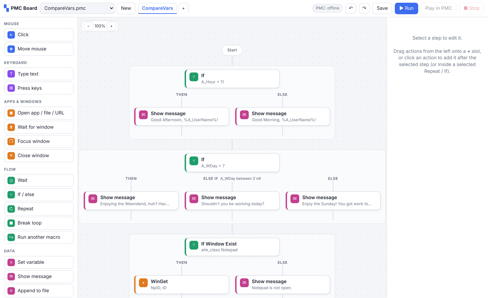

# Changelog

Changes in this fork (**RPA-Macro-AI**) compared with the original
[Pulover's Macro Creator](https://github.com/Pulover/PuloversMacroCreator) at commit `b88433e`
("Fixed virus warnings", v5.4.1, September 2021).

The original program is unchanged apart from a few small hooks. Everything new is opt-in: PMC
behaves exactly as before unless you start it with `-agent`, use **File → Visual Board…**, or
install the `Agent/` package.

## Unreleased: AI agents, RPA and Visual Board

### Highlights

- **AI agents can use PMC as an RPA engine** through the Model Context Protocol (MCP), from
  Claude Desktop, Claude Code or any other MCP client.
- **Visual Board:** a drag-and-drop flow editor for PMC macros that runs in the browser.
- **Run macros with parameters:** pass input variables in and get output variables back, with a
  timeout.
- **Record and replay:** an agent can start PMC's recorder, let you demonstrate a task, and read
  back the recorded steps.

### Added: inside Pulover's Macro Creator

| Change | Where |
|---|---|
| **Agent bridge:** JSON commands over PMC's existing WM_COPYDATA channel: `ping`, `status`, `open`, `save`, `get_macro`, `select`, `play`, `stop`, `record_start`, `record_stop`, `show`, `hide`. Replies are written atomically to `%TEMP%\PMC_Agent\<id>.json`; a discovery file `bridge.json` holds the window handle. Off by default. | `LIB/AgentBridge.ahk` (new) |
| `-agent` command-line switch, and `[Options] AgentBridge=1` in `MacroCreator.ini`, turn the bridge on. | `MacroCreator.ahk` |
| `-new` command-line switch always starts a separate instance, so headless `-s` runs aren't handed to a PMC window that's already open. | `MacroCreator.ahk` |
| **File → Visual Board…** menu item: saves the project if needed, turns the bridge on, and opens the board on the current file. | `MacroCreator.ahk` |
| `Receive_Params` passes bridge messages (`dwData = 0x504D4341`) to the bridge; the existing "open files" behaviour is unchanged. | `LIB/Internal.ahk` |

### Added: `Agent/` Python package (`pip install ./Agent`)

**MCP server, `pmc-mcp` (27 tools)**

| Group | Tools |
|---|---|
| Macro files | `macro_list_files`, `macro_read`, `macro_step_kinds`, `macro_create`, `macro_add_steps`, `macro_update_step`, `macro_delete_steps` |
| Execution | `macro_run`: headless run with `inputs` → `outputs`, a timeout, and a "completed" check |
| Live PMC | `pmc_launch`, `pmc_status`, `pmc_open`, `pmc_save`, `pmc_window`, `pmc_play`, `pmc_stop`, `pmc_record_start`, `pmc_record_stop`, `pmc_get_live_macro` |
| Visual Board | `board_open` |
| Desktop (Windows) | `desktop_screenshot` (with a scale factor for mapping coordinates), `desktop_list_windows`, `desktop_window`, `desktop_click`, `desktop_send_keys`, `desktop_pixel_color`, `desktop_image_search`, `desktop_run_ahk` (permission level `full` only) |

- **Lossless `.pmc` reader and writer:** all 11 bundled example projects round-trip byte for byte.
- **Step builders:** agents describe steps as simple JSON (`{"kind": "click", "x": 10, "y": 20}`),
  which become exactly the rows PMC's own command windows write.
- **Safety:**
  - File access is limited to the folders in `PMC_MCP_ROOTS`.
  - Permission levels `readonly`, `standard` and `full`.
  - A JSON-lines audit log of every action.
  - Errors are returned to the agent as readable messages.
- Works with MCP Python SDK 2.x and 1.x.

**Visual Board, `pmc-board`**

- **Building:**
  - A palette of actions: mouse, keyboard, apps and windows, flow (wait, if/else, repeat, break,
    run another macro), data, and any AHK command.
  - Drag an action onto a **+** slot, or click it to add it after the selected step. If a Repeat
    or If block is selected, the action goes inside it.
  - If / Else if / Else branches sit side by side; loops wrap their steps.
- **Editing:**
  - A settings form for each step. Steps without a form are edited as raw PMC rows.
  - Undo/redo, Ctrl+S, Delete, Ctrl+D (duplicate), Escape, zoom, macro tabs (add, rename),
    disable steps, notes.
- **Same files as PMC:**
  - Steps you don't touch are saved unchanged.
  - Editing a step through its form never changes its other columns. This is checked against
    every example row.
  - Macros whose If/Loop blocks don't balance are shown as a flat list and still saved unchanged.
- **Running:** **▶ Run** runs the macro headless with input and output variables; **Play in PMC**
  and **■ Stop** control the open PMC window.
- **Works alongside agents:** reloads live when an agent edits the open file; if you have unsaved
  edits, a banner lets you choose instead.
- **Security:**
  - Listens on `127.0.0.1` only, with a per-launch access token.
  - Checks the Host header (protects against DNS rebinding) and blocks path traversal.
  - Detects when two people or tools save the same file at once.
  - Exits about two minutes after you close the tab.
- Light and dark themes, a phone-width layout, and no external libraries or CDN (works offline).

| | |
|---|---|
|  |  |
| Building a flow from the palette | Running with input and output variables |
|  |  |
| Repeat blocks and macro tabs (PMC's LoopTypes example) | If / Else if / Else in dark mode |

### Changed

- `README.md` now has a section on AI agents, RPA and the Visual Board.

### Tests

116 automated tests (`cd Agent && pip install -e .[test] && pytest`), runnable on any OS:

- `.pmc` round trips and block-tree round trips for every bundled example.
- Every step the board shows as a form rebuilds to the identical row.
- MCP tools end to end, against a simulated agent bridge and a fake PMC executable (including the
  timeout kill).
- The board's HTTP API and its security checks.
- Browser tests that drive the real board in Chromium.

### Known limitations

- **Not yet run on Windows:** `LIB/AgentBridge.ahk`, the File → Visual Board menu item, the Win32
  messaging, and the AutoHotkey snippets behind the `desktop_*` tools. They were written against
  PMC's source and AutoHotkey v1.1 semantics, but this work was built in a Linux environment.
- The board is a structured flow (sequence, branches, loops), not a free-form node graph. That
  keeps every board flow a valid PMC macro.
- Image/pixel search and some less common commands have no form on the board yet; they show as
  raw PMC rows.
- At the `standard` permission level an agent can effectively control the computer as the
  signed-in user, because macros can run any program. Use a separate Windows account or a VM for
  unattended automation.
