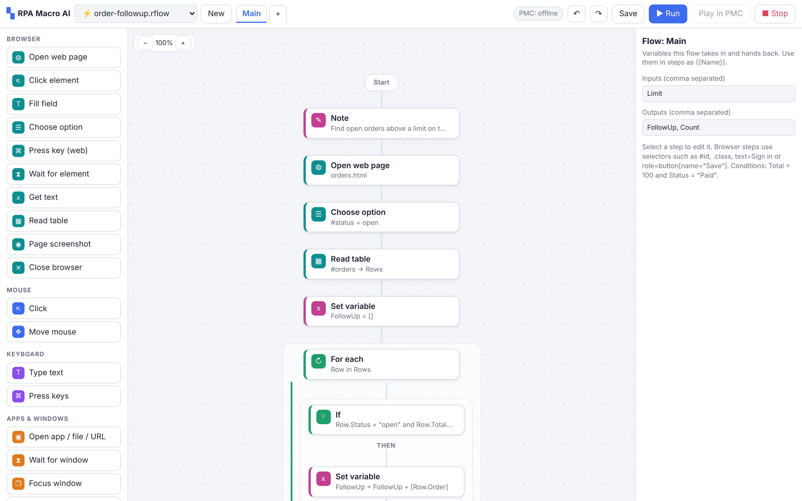
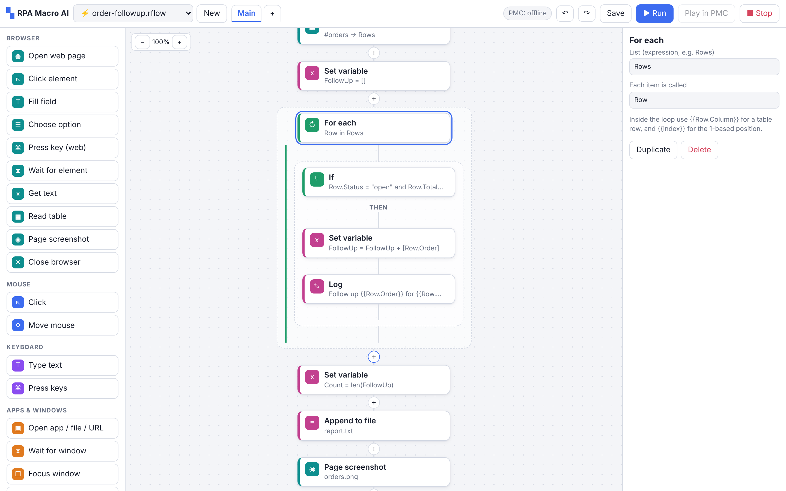
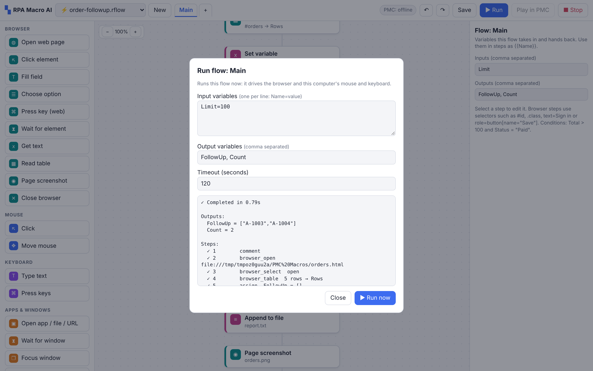
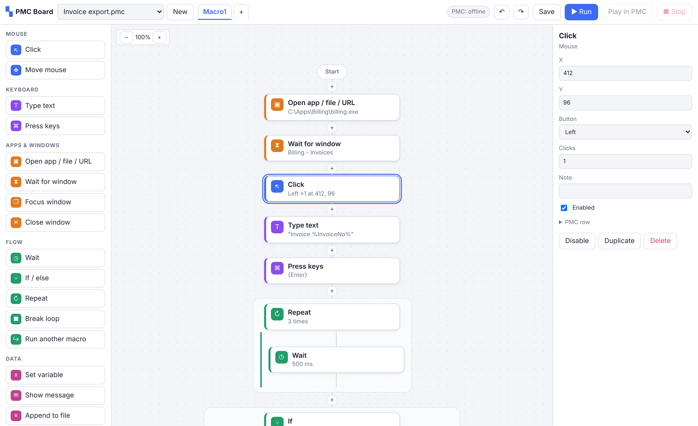
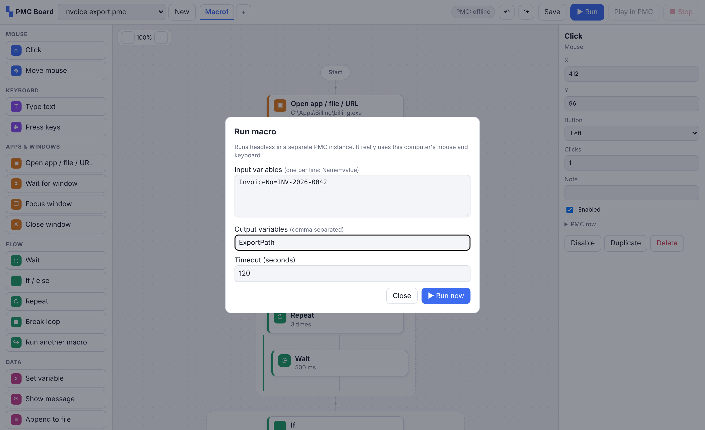
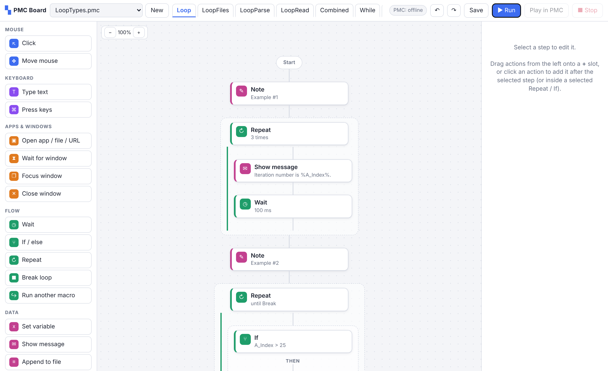
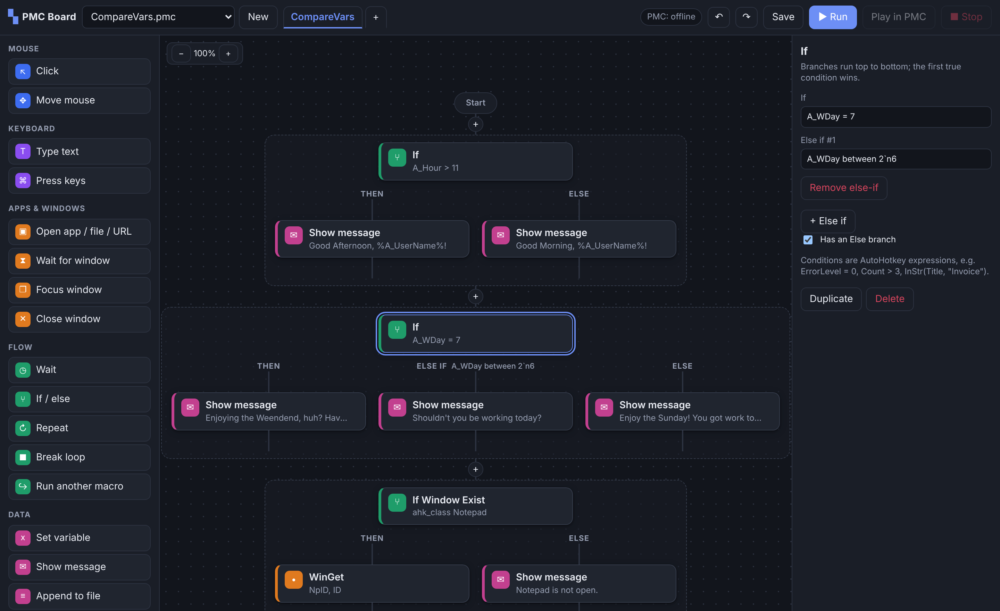

# Changelog

Changes in this fork (**RPA-Macro-AI**) compared with the original
[Pulover's Macro Creator](https://github.com/Pulover/PuloversMacroCreator) at commit `b88433e`
("Fixed virus warnings", v5.4.1, September 2021).

The original program is unchanged apart from a few small hooks. Everything new is opt-in: PMC
behaves exactly as before unless you start it with `-agent`, use **File → Visual Board…**, or
install the `Agent/` package.

## Unreleased: AI agents, RPA and Visual Board

### Highlights

- **RPA Macro AI: browser + desktop in one tool.** Playwright browser automation, a flow engine
  (`.rflow`) that mixes browser steps, desktop steps and PMC macros with variables and loops, and
  the same flows on the Visual Board, from the command line, for AI agents over MCP and on
  UiPath, Robomotion and Automation Anywhere.

- **AI agents can use PMC as an RPA engine** through the Model Context Protocol (MCP), from
  Claude Desktop, Claude Code or any other MCP client.
- **Visual Board:** a drag-and-drop flow editor for PMC macros that runs in the browser.
- **Run macros with parameters:** pass input variables in and get output variables back, with a
  timeout.
- **Record and replay:** an agent can start PMC's recorder, let you demonstrate a task, and read
  back the recorded steps.

### Added: browser automation and flows

- **Browser engine** (`pmc_mcp/browser.py`):
  - Playwright on a dedicated thread, using Edge on Windows by default, or Chrome or any Chromium.
  - Open, list interactive elements with refs for agents, click, fill, press, select, wait, read
    text or attributes, read whole tables as row records, and take screenshots.
  - `PMC_BROWSER_PROFILE` keeps logins between runs.
  - `file://` pages are only allowed inside the macro folders.
- **Flow engine** (`pmc_mcp/engine.py`) for `.rflow` files:
  - Mixes browser steps, desktop steps (AutoHotkey) and `run_macro` (a PMC macro with inputs, whose
    outputs become flow variables).
  - Variables, `{{templates}}`, If / Else if / Else, Repeat, **For each**, Break and Log.
  - Timeouts and stop.
  - A step log, and errors that name the failing step (`step 6[3].1.1 (browser_click): …`).
  - Conditions use a small, safe expression language with no `eval`, accepting PMC habits such
    as `=` for equality.
  - Relative paths resolve next to the flow.
- **MCP tools for agents:**
  - Browser: `browser_open`, `browser_snapshot`, `browser_click`, `browser_fill`, `browser_press`,
    `browser_select`, `browser_wait`, `browser_extract`, `browser_table`, `browser_screenshot`,
    `browser_close`, and `browser_evaluate` at level `full`.
  - Flows: `flow_step_kinds`, `flow_create`, `flow_read`, `flow_update`, `flow_run`, `flow_stop`.
  - Agents write flows in a compact nested form, which converts to and from the board format
    losslessly.
- **Visual Board** edits and runs flows:
  - The palette adapts to the file (a Browser group, For each, Run PMC macro, Log).
  - Flow inputs and outputs, editing For each and Else if, and running with inputs while seeing
    outputs and the step log.
  - **New** creates a flow by default.
- `pmc-run` and `run_json` run `.rflow` flows as well as `.pmc` macros, so UiPath, Robomotion and
  Automation Anywhere get flows and browser automation too.
- **Example:** `Agent/examples/order-followup`, a sample orders page and a flow that filters it,
  reads the table, picks big open orders, writes a report and takes a screenshot. Its Notepad steps
  are off by default.
- Desktop primitives moved into the shared `pmc_mcp/desktop.py`, used by both the MCP tools and
  the engine.
- **Fixed:** `file://` pages in folders with spaces, such as the default `Documents\PMC Macros`,
  were refused. `pmc-board` and `board_open` couldn't open `.rflow` files directly.

| | |
|---|---|
|  |  |
| For each over a scraped table, with an If inside | Running a flow: outputs and step log |

### Added: inside Pulover's Macro Creator

| Change | Where |
|---|---|
| **Agent bridge:** JSON commands over PMC's existing WM_COPYDATA channel: `ping`, `status`, `open`, `save`, `get_macro`, `select`, `play`, `stop`, `record_start`, `record_stop`, `show`, `hide`. Replies are written atomically to `%TEMP%\PMC_Agent\<id>.json`; a discovery file `bridge.json` holds the window handle. Off by default. | `LIB/AgentBridge.ahk` (new) |
| `-agent` command-line switch, and `[Options] AgentBridge=1` in `MacroCreator.ini`, turn the bridge on. | `MacroCreator.ahk` |
| `-new` command-line switch always starts a separate instance, so headless `-s` runs aren't handed to a PMC window that's already open. | `MacroCreator.ahk` |
| **File → Visual Board…** menu item: saves the project if needed, turns the bridge on, and opens the board on the current file. | `MacroCreator.ahk` |
| `Receive_Params` passes bridge messages (`dwData = 0x504D4341`) to the bridge; the existing "open files" behaviour is unchanged. | `LIB/Internal.ahk` |

### Added: `Agent/` Python package (`pip install ./Agent`)

**MCP server, `pmc-mcp` (27 tools)**

| Group | Tools |
|---|---|
| Macro files | `macro_list_files`, `macro_read`, `macro_step_kinds`, `macro_create`, `macro_add_steps`, `macro_update_step`, `macro_delete_steps` |
| Execution | `macro_run`: headless run with `inputs` → `outputs`, a timeout, and a "completed" check |
| Live PMC | `pmc_launch`, `pmc_status`, `pmc_open`, `pmc_save`, `pmc_window`, `pmc_play`, `pmc_stop`, `pmc_record_start`, `pmc_record_stop`, `pmc_get_live_macro` |
| Visual Board | `board_open` |
| Desktop (Windows) | `desktop_screenshot` (with a scale factor for mapping coordinates), `desktop_list_windows`, `desktop_window`, `desktop_click`, `desktop_send_keys`, `desktop_pixel_color`, `desktop_image_search`, `desktop_run_ahk` (permission level `full` only) |

- **Lossless `.pmc` reader and writer:** all 11 bundled example projects round-trip byte for byte.
- **Step builders:** agents describe steps as simple JSON (`{"kind": "click", "x": 10, "y": 20}`),
  which become exactly the rows PMC's own command windows write.
- **Safety:**
  - File access is limited to the folders in `PMC_MCP_ROOTS`.
  - Permission levels `readonly`, `standard` and `full`.
  - A JSON-lines audit log of every action.
  - Errors are returned to the agent as readable messages.
- Works with MCP Python SDK 2.x and 1.x.

**Visual Board, `pmc-board`**

- **Building:**
  - A palette of actions: mouse, keyboard, apps and windows, flow (wait, if/else, repeat, break,
    run another macro), data, and any AHK command.
  - Drag an action onto a **+** slot, or click it to add it after the selected step. If a Repeat
    or If block is selected, the action goes inside it.
  - If / Else if / Else branches sit side by side; loops wrap their steps.
- **Editing:**
  - A settings form for each step. Steps without a form are edited as raw PMC rows.
  - Undo/redo, Ctrl+S, Delete, Ctrl+D (duplicate), Escape, zoom, macro tabs (add, rename),
    disable steps, notes.
- **Same files as PMC:**
  - Steps you don't touch are saved unchanged.
  - Editing a step through its form never changes its other columns. This is checked against
    every example row.
  - Macros whose If/Loop blocks don't balance are shown as a flat list and still saved unchanged.
- **Running:** **▶ Run** runs the macro headless with input and output variables; **Play in PMC**
  and **■ Stop** control the open PMC window.
- **Works alongside agents:** reloads live when an agent edits the open file; if you have unsaved
  edits, a banner lets you choose instead.
- **Security:**
  - Listens on `127.0.0.1` only, with a per-launch access token.
  - Checks the Host header (protects against DNS rebinding) and blocks path traversal.
  - Detects when two people or tools save the same file at once.
  - Exits about two minutes after you close the tab.
- Light and dark themes, a phone-width layout, and no external libraries or CDN (works offline).

| | |
|---|---|
|  |  |
| Building a flow from the palette | Running with input and output variables |
|  |  |
| Repeat blocks and macro tabs (PMC's LoopTypes example) | If / Else if / Else in dark mode |

**Other RPA platforms** (`Agent/integrations/`)

- **UiPath:** packaging for publishing `pmc-mcp` to Orchestrator as a coded MCP server with
  UiPath's MIT-licensed `uipath-mcp` SDK.
  - `uipath init` and `uipath pack` were verified with uipath-mcp 0.3.2.
  - The packed server was started from the `.nupkg` with only its declared dependencies and served
    all 27 tools.
  - `prepare.py` bundles `pmc_mcp`, because UiPath's packer mangles git dependencies.
- **Robomotion:** a `robomotion-mcps` catalog entry (`.robomotion/mcp.yaml`, `MCP.md`,
  `env.optional`). It passes the catalog's own `validate.sh` and `build-index.py`, and its
  `uvx … pmc-mcp` launch command was tested.
- **Automation Anywhere:** a step-by-step guide for running macros from AA bots through the
  Python Script package (`run_json`) or Application › Open program (`pmc-run --result-file`).
- **`pmc-run` CLI:** runs a macro headless from any tool and prints JSON. It supports
  `--input`, `--output`, `--json`, `--timeout` and `--result-file`, with exit codes 0 completed,
  2 incomplete, 3 timed out, 1 error.
- **`pmc_mcp.cli.run_json`:** one JSON string in, one JSON string out, and it never raises.

### Changed

- `README.md` now has a section on AI agents, RPA and the Visual Board.

### Tests

152 automated tests (`cd Agent && pip install -e .[test] && pytest`), runnable on any OS:

- `.pmc` round trips and block-tree round trips for every bundled example.
- The flow engine (expressions, blocked escapes, blocks, timeouts, stop) and the browser engine in
  real Chromium, including the shipped example flow and the live `browser_*` MCP tools.
- Every step the board shows as a form rebuilds to the identical row.
- MCP tools end to end, against a simulated agent bridge and a fake PMC executable (including the
  timeout kill).
- The board's HTTP API and its security checks.
- Browser tests that drive the real board in Chromium.

### Known limitations

- **Not yet run on Windows:** `LIB/AgentBridge.ahk`, the File → Visual Board menu item, the Win32
  messaging, the AutoHotkey snippets behind the desktop steps and `desktop_*` tools, and the Edge
  browser channel. Browser automation itself is tested in Chromium. They were written against
  PMC's source and AutoHotkey v1.1 semantics, but this work was built in a Linux environment.
- The board is a structured flow (sequence, branches, loops), not a free-form node graph. That
  keeps every board flow a valid PMC macro.
- Image/pixel search and some less common commands have no form on the board yet; they show as
  raw PMC rows.
- The UiPath, Robomotion and Automation Anywhere integrations were checked with each platform's
  own tooling where it's public, but none has been run against a real tenant, hub or Control
  Room. UiPath marks MCP-server packages as not needing a desktop session, so make sure
  Orchestrator runs this one on a Windows robot with a logged-in desktop.
- At the `standard` permission level an agent can effectively control the computer as the
  signed-in user, because macros can run any program. Use a separate Windows account or a VM for
  unattended automation.
